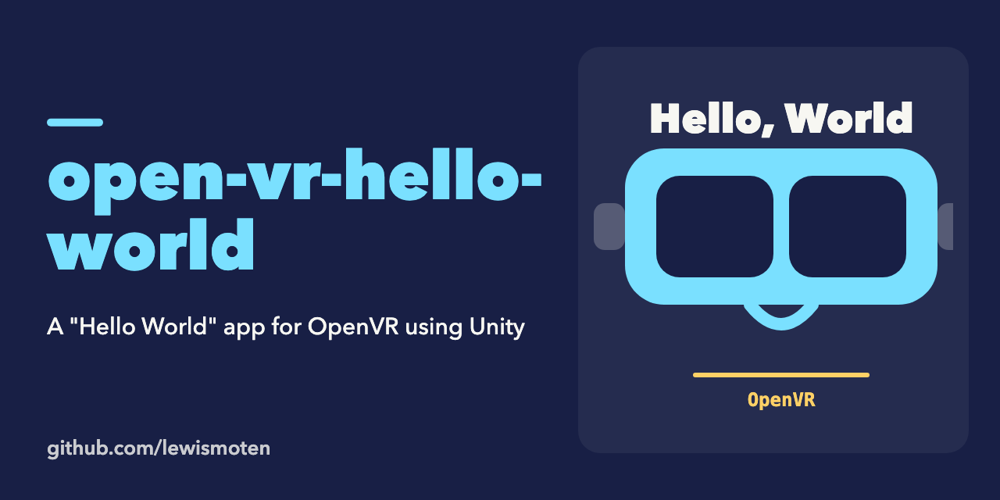

# open-vr-hello-world

A "Hello World" app for OpenVR, made with Unity.

Status: experiment from 2017 (Unity 2017.1), not maintained. Open the folder as a project in Unity and load the scene in `Assets/`.

## License

MIT. See [LICENSE.md](LICENSE.md).
